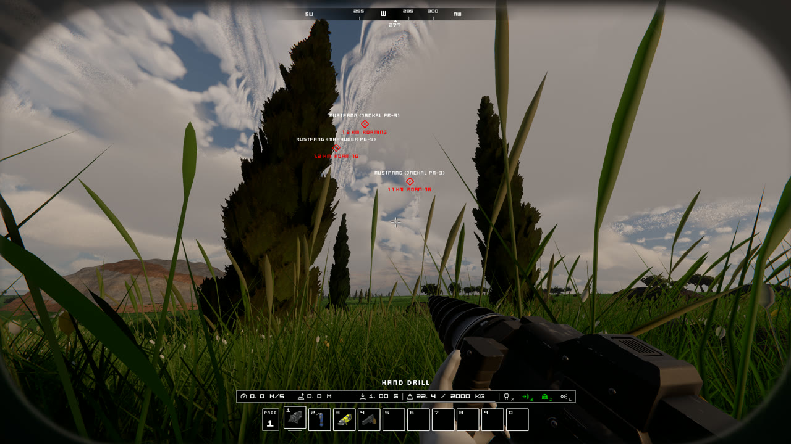
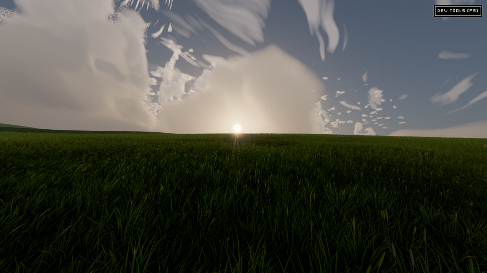
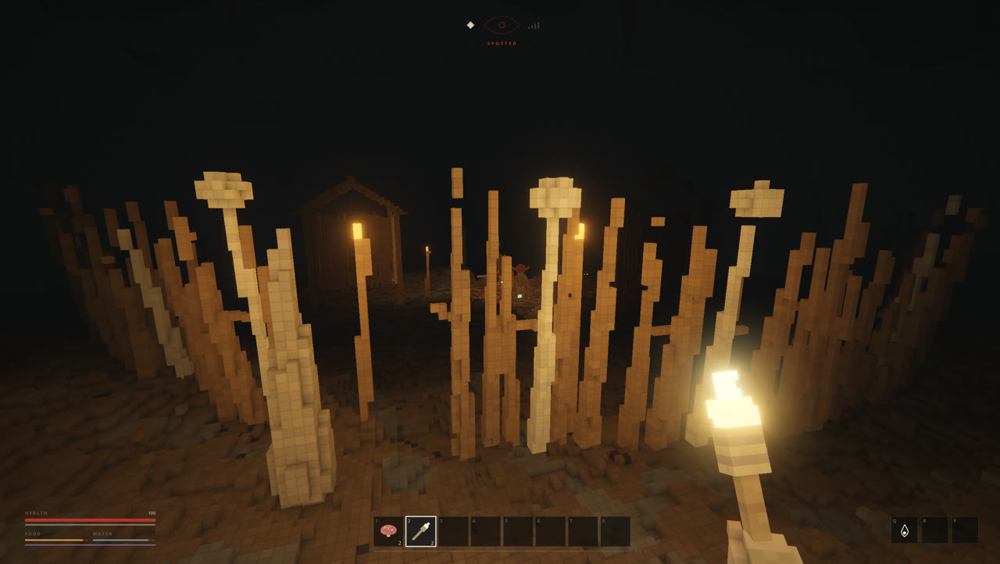

# hey, I'm invalido

I make games and other small, strange things in C++, mostly on engines I write myself.

  
  

## Some of the stuff I've made

  

<table>
  <tr>
    <td width="50%"></td>
    <td width="50%"></td>
  </tr>
  <tr>
    <td width="50%"></td>
    <td width="50%"></td>
  </tr>
</table>

## Tools

  
  
  
  

